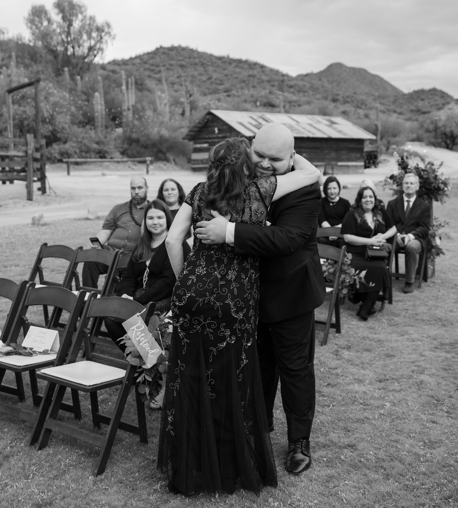
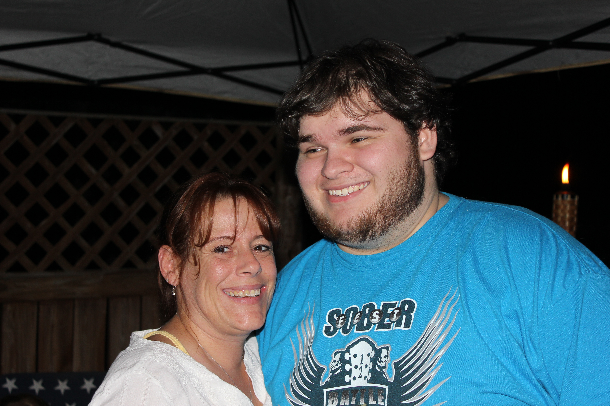
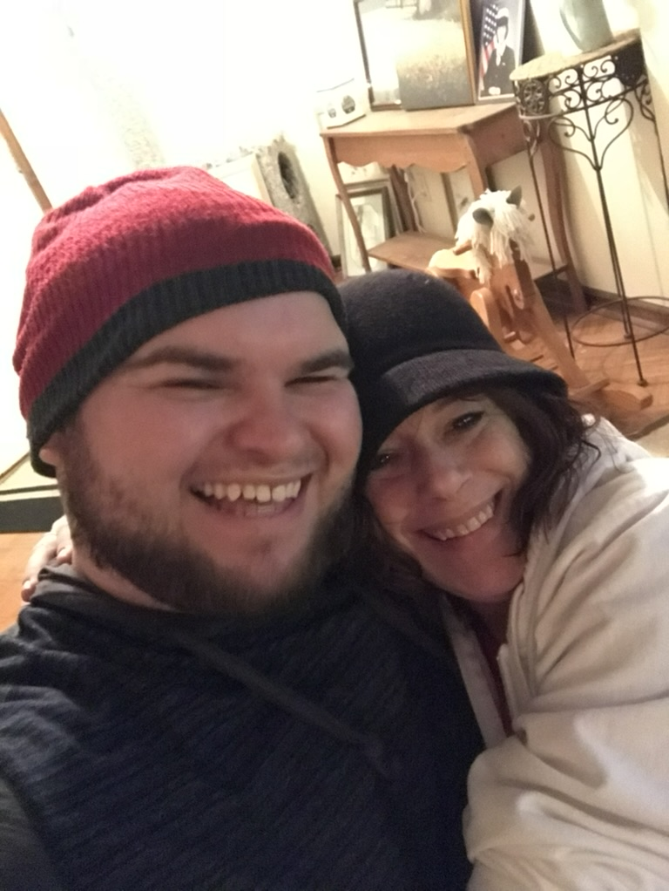
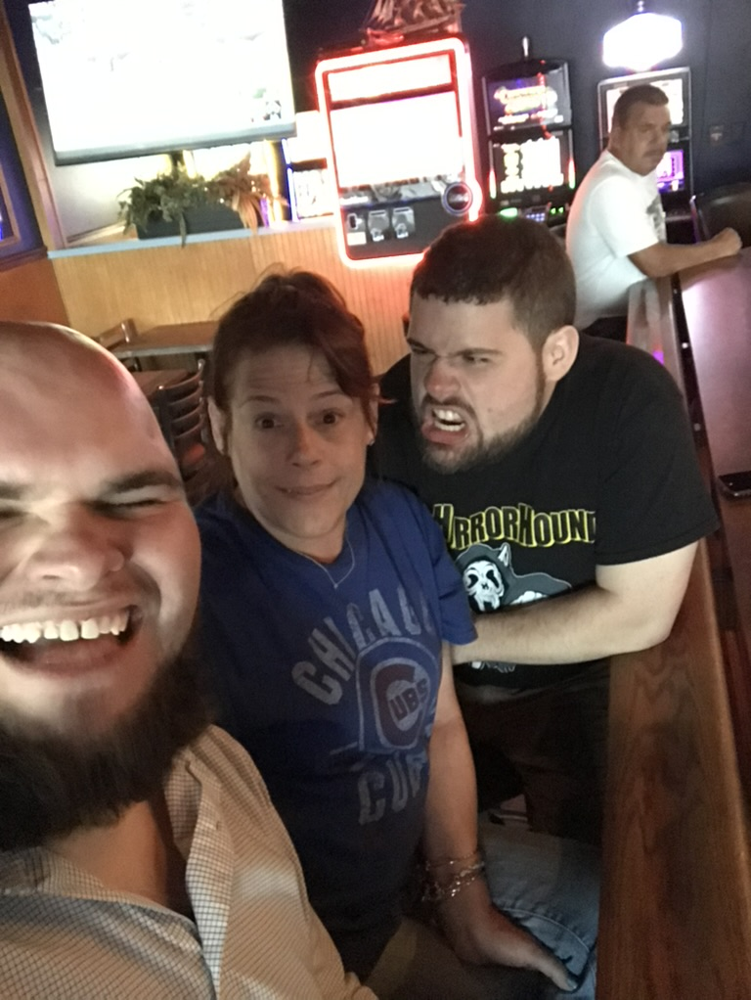
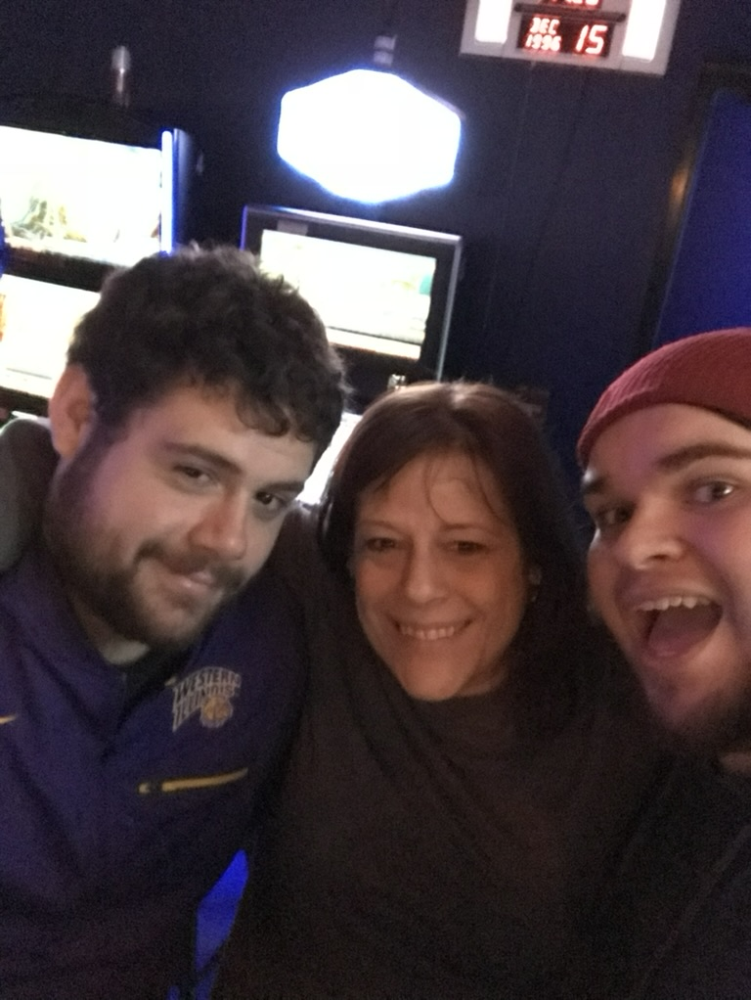
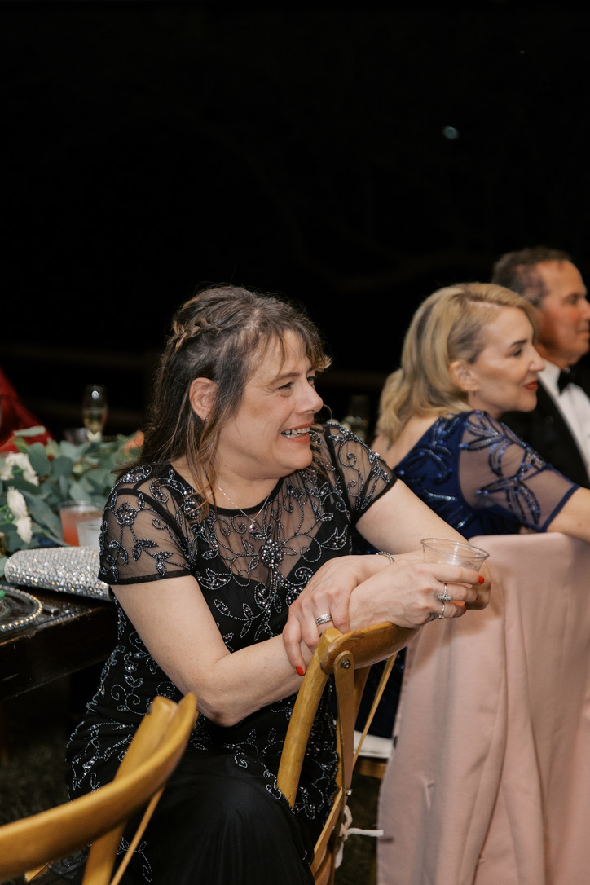
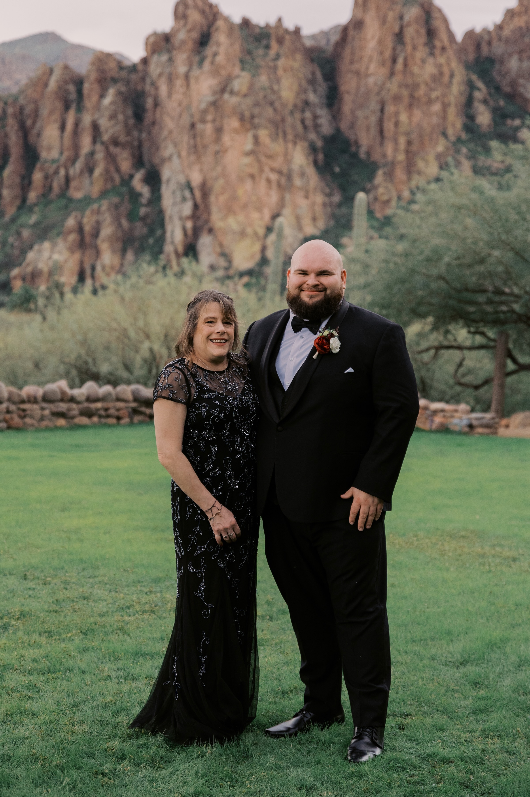

The thing about death is that it makes old photos mean something new. You notice details you never saw before. 

Shelly was the mom I never had. Everything I am now, I can trace back to a foundation she gave me. 

When I first met Shelly, I thought she was the coolest mom ever. When she learned I was coming over, she ordered me and my friend pizza. Shelly was my friend's mom, but she was really a mom to all who needed it. I remember the night I met her, she was interested in my living situation at the group home. We talked for a long time, and she wept hearing my story. I barely knew her, yet I already felt at home. I could tell that she was someone who cared.

When I turned 18, I aged out of the group home. They helped pay for an apartment for me at first, but after a few months, I had to start paying all the bills myself. At the time, I worked at Wendy's making $7.25 an hour. I had no idea how I would ever afford $500 a month.

I didn't do well with this situation. I was not ready to be on my own. She saw that and didn't want to watch me fall. So she took me in to live with her, alongside her two sons and a girl who also had a difficult childhood. She tried her hardest to treat us all as her kids. Every lesson one of us got echoed to the others.

> My kids will not be a statistic.
> <cite>Rochelle "Shelly" Simpson</cite>

She believed we would succeed even when we didn't.

She guided me through the most transformative years of my life. Shelly had a rough life of her own, yet as a single mom she put her everything into bettering her kids—and even when we were at our worst, she didn't give up.

Even when I was at my lowest, dealing with grief and on the verge of being placed on academic leave in college, Shelly gave me space to figure it out. Because of that, I was able to graduate college, forge my own path, and move to Arizona.

She taught me that hard work is the only way through. Not the toxic grind you see on Instagram. Not suffering for the sake of it. She meant showing up for what your heart wants and refusing to back down when it gets hard. Shelly taught us to be brave even when we were surrounded by darkness.

I write this because her legacy—and the life she lived—deserves to be preserved. She was a light in darkness. If my website can serve one purpose, more than anything, I want future digital historians to know that this woman was amazing and worth remembering.

---

I don’t think you knew how much that meant to me. I don’t think you knew how much any of it meant to me. I didn’t say it enough. I didn’t say it at all, really. I think I assumed there would be more time. There’s never more time…

Life will never be the same without you. 

::gallery

::
