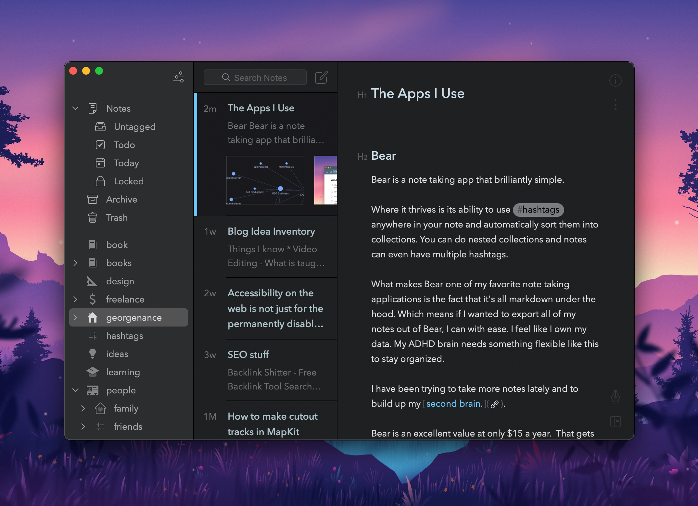
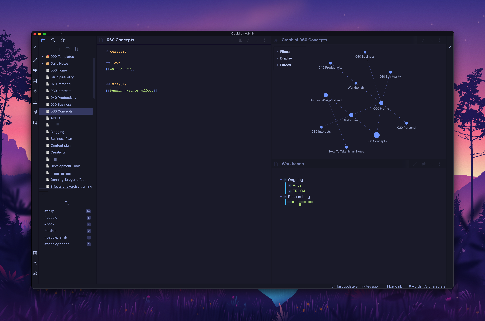
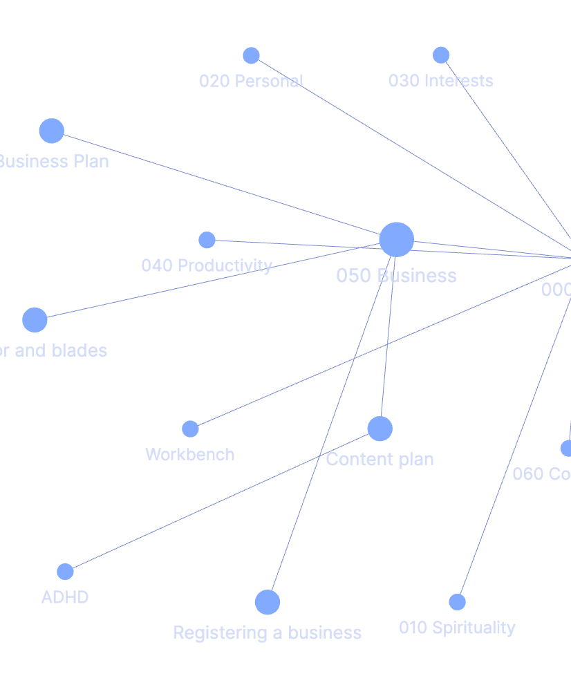
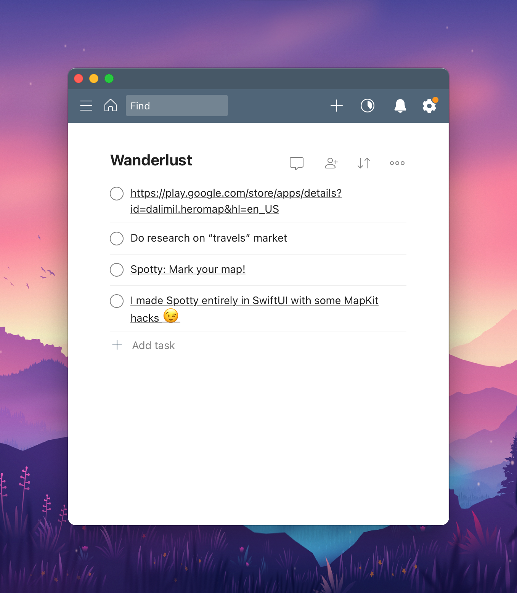
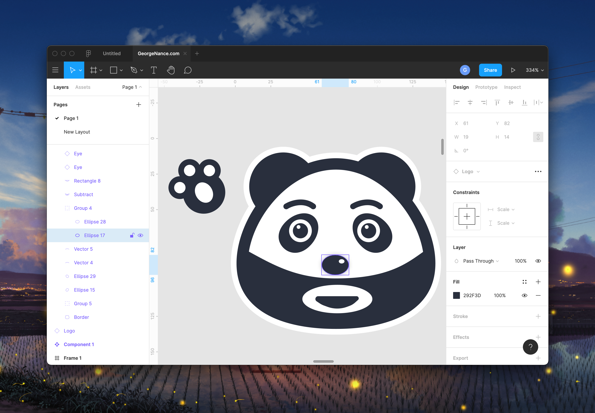

::callout
This list is a bit outdated, I recommend looking at [my updated list](/bag)
::

Staying productive in a digital world can be hard without the right tools. I have assembled a list of great apps that I use everyday that make my life easier. 

## [Bear](https://bear.app)
Bear is a note taking app that brilliantly simple.  

Where it thrives is its ability to use anywhere in your note and sort them into collections. 

What makes Bear one of my favorite note taking applications is the fact that it's all markdown under the hood. Which means if I wanted to export all my notes out of Bear, I can with ease. I like that I own my data. My ADHD brain needs something flexible like this to stay organized. 

I have been trying to take more notes lately and to build up my [second brain.](https://fortelabs.co/blog/basboverview/)

Bear is an excellent value at only $15 a year.  That gets you a mobile app and a desktop app. The developers behind Bear are also working a major rewrite to make a web version as well.

## [Obsidian](https://obsidian.md)

Obsidian is the newest player in my arsenal. It is a research note taking app created during the Covid-19 lockdown as a fun project. quickly evolved into quite a hit.

What makes Obsidian different ? Its based off of the [zettelkasten](https://en.wikipedia.org/wiki/Zettelkasten) system.  Which is a system of taking notes and linking them together with certain phrases or words. 

I will be the first to tell you I am no expert at this system but I love the idea of having my own database of knowledge. 

Obsidian comes into play because they support backlinks in notes. Which is a way to connect 2 markdown files to each other. Obsidian also has this cool feature to see how your notes connect. 

It has become one of my favorite apps and has tons of features like a daily notes. The app uses CSS for custom themes so it's a breeze to make it look how you want. 

Right now I am using it alongside Bear to import notes that I want to move to a more permanent solution.

## [Todoist](https://todoist.com/r/georgenancejr_ujvbmr)

Todoist is a new one for me. For a long time I opposed this kinda of "subscription todo app", but it has been very beneficial in helping get my life together.  The neat thing about about Todoist is projects and the ability to separate many tasks. 

## [Figma](https://www.figma.com)

Figma is a blast to work with for creating icons or UI mockups . 

The fact that is free blows my mind.  I have started to work on my own icon-set in it. My logo was also created in it. It's a joy to use. 

Plus it has the ability to collaborate easily with real time editing.

## Conclusion

These are just a few apps I use. I plan to write more about the other ones I love. 