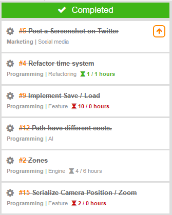

> ### The ultimate inspiration is the deadline.
>
> -Nolan Bushnell, Atari

When I think of deadlines, I think of late nights staying up working on school essays the night before it was due. Me and deadlines have always had a discomforting relationship. I was a bit of a slacker and I would always wait until the last moment to get something done. But what if deadlines are actually very useful, especially for an independent game developer?

One of the major appeals of indie game development is that you don't have anyone to answer to. This is the best part of being independent. But this is a double-edged sword. As we develop a game, we may start to get a lot of "_I will need to work on that later"_ moments. Perhaps, we don't feel comfortable writing a new animation system for our game yet. Or what we need to work on isn't very fun to work on. It is very easy to get sucked into working on fun and interesting features only. It can get so bad, that we create new features to add instead of working on what needs done. So we just keep pushing back the boring stuff like a school assignment on a friday night. Until one day, we need to get it done and it is so overwhelming that we start to lose interest in the project.

#### **Does this sound like you at all?**

In the game industry, deadlines are not always seen as a good thing. Larger video game companies often have very strict deadlines and will force their workers into crunch time to meet them. [Video game companies ruining lives with crunch time is still a very real thing.](https://www.theguardian.com/technology/2015/feb/18/crunched-games-industry-exploiting-workforce-ea-spouse-software) Crunch is what happens when smaller deadlines are not met. It forces developers to do a lot of work near the end, instead of evenly distributing it. This is usually the result of poor time management. By simply using a system of smaller deadlines instead of one hard deadline, work can be done without the need for crunch. It is like your teachers tell you, write a little bit of your essay every day instead of waiting until the last few days. When you work for yourself, you have to answer to yourself.

The truth is, deadlines are very useful. It requires us to manage our time and resources to get a task done. Feature creep can be a problem if not managed. By placing a deadline on something, you learn to manage your time better. It is a promise you made to yourself to get something done. A deadline may be exactly what is needed if you feel that your game has not made much progress.

> ### Deadlines refine the mind. They remove variables like exotic materials and processes that take too long. The closer the deadline, the more likely you'll start thinking waaay outside the box.
>
> Adam Savage, Mythbusters

Last month I started using a program called [HacknPlan](https://hacknplan.com/). It is planning tool web application that helps game developers manage their tasks. It is a bit similar to [Trello](https://trello.com). But it is more engineered toward game developers and comes with many useful out of the box features for them. One feature that has improved my workflow is _milestones_. A milestone is a set of tasks you want to get done by a certain date. I sat down one day and just laid out all of the features I wanted to get done in the next month. It turned out to be successful and I worked tirelessly to crank out those extra features before the milestone ended. It felt like I was really making progress by completing smaller tasks. Anything that may take too long, I push to the next month and raised the priority. I would work the highest priority tasks first then move down to lower priority tasks. So even if I missed the deadline for a feature, I would have to get it done before I could work on the other features. By splitting up what I did into tasks, it was easier to see if an idea I came up with would work with my vision of the game.

_Working a full-time job did not leave me a lot of time for tasks, but I got most of them done_

So this is my challenge to you. If you are having issues with getting things done, If you find yourself abandoning projects because you are overwhelmed, or if your game still does not have its main mechanic implemented, then try a _deadline_. Use a website like [HacknPlan](https://hacknplan.com/), [Trello](https://trello.com), or even just a notepad and arrange your tasks you want to get done this month. Then break it down to what you want to get done each week. Stick to this system and you will see results.

**Treat your time and skills like they are your business.**

[Here is a great TED talk on this subject.](https://www.ted.com/talks/tim_urban_inside_the_mind_of_a_master_procrastinator) Thanks to [Ooozuz](https://www.reddit.com/user/Ooozuz) for recommending it.
