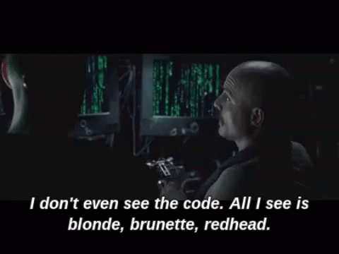

Dear weary novice programmer,

Do not give up. I promise it will all make sense soon. Learning to program is not an exercise of remembering commands but the ability to change how you think. Learning to program is bigger then having the ability to write computer programs. It will teach you how to live a more optimal life.

I am going to share with you some advice I would have given myself when I first started.

## Everyone feels like they are faking it.

I know that you think that this way over your head. But I promise it will take time to get used to. Not a single soul born knows how to code. In the same sense, no one is born knowing how to walk. Only persistance will give you the results you want. Do not compare yourself or your code to others. **This is the quickest way to hating your work**.

## You must write garbage code first

The worst thing you can do is take on a massive project in the beginning. When I was a wee lad, I loved the movie the Social Network. The movie revolved around Mark Zuckerberg starting Facebook from his college dorm room. I would get so inspired after watching that I would proclaim to my friends, “I”m going to build the next Facebook!”. Then I would open up my ~~pirated~~ copy of Adobe DreamWeaver and pretend to know was doing.

At the time, I did not know much html. And the only css I knew was how to the change the color of text. But I was going to write the next Facebook.

#### Spoiler Alert: _I didn’t write the next Facebook_.

The truth is, Facebook was **not** Zuckerberg’s first website. He was already an experienced programmer by the time he started Facebook. And no one talks about the projects he made before he got to Harvard. That’s an important thing to remember, your first projects are going to suck and no one but you will want to use them. And that’s okay!

In the game development community, there is a common piece of advice given to beginners. “Don’t write an MMO as your first game”. It's not surprising that aspiring gamedevs come into the field wanting to create the games they enjoy playing. This advice is not meant to be discouraging. What said is that you have to crawl before you can walk. If you dediate yourself to a huge project early on, you will become overwhelmed and burn out.

But if you accept that your first works will suck, you will grow and learn what you can do. The faster you get past the sucky bits, the faster you get to the _not so bad_ parts.

## Programming is a change in mindset

Learning to program is not about learning how to use the latest Javascript libraries. Its not about learning how binary works (Though that’s not a bad path). Its not even about learning a language . Learning to program is an entire shifting of the way you think.

<small>
At a certain point, you don't even see what normal people see looking at code
</small>

Here’s the thing about computers. Computers are purely logical. A computer will do what it's told. A computer knows only the information its given. If your program is not doing something you want, this means you need to step through how the computer is interpreting what's being told.

This can be a foreign concept for some. You have to think like a computer. People who tend to be better at math pick up programming a bit quicker. For me, I am not naturally good at math, so this took me a long time to grasp.

## Experienced programmers question their expertise all of the time

To this day I still question if I am an imposter and I have been programming for over 10 years. At my new job, they are using a framework I was not familiar with. I had a difficult time trying to understand the way the framework wants me to use it. No matter how many languages or framework you learn, you will always have moments like these.

There is always a period of time where you are typing code you don't fully understand. Then there will be an "aha!" moment where it all makes sense. This is called the _click_. Sometime it takes weeks or months to get there. We all have to go through it. You are not dumb, it just has not clicked for you yet.

Programming is more about the ability to love learning than it is about remembering what you have learned. If you hate learning new things, you will have a hard time in this field. But if you love learning, you will find this very rewarding .

## The click will come

You are not alone if has not come yet. It all comes back to shifting your way of thinking. And that takes time. For a long time I wrote code without knowing what it did.

This is something that you must trust to come. You can not fight it or skip any steps.

## What you can do

Do not dispair, if you can accept that time will improve your skills, there is action you can take.

- Set aside some time everyday to program.

- Try to make a project that will help you.
- Look through these lists and try to complete a project on your own.
  - [Mega Project List](https://github.com/karan/Projects)
  - [Project Based Learning](https://github.com/tuvtran/project-based-learning)
  - [Beginner Projects](https://github.com/jorgegonzalez/beginner-projects)
- Keep learning. Don't stop watching tutorials or taking classes. Ask questions on [Dev.to](https://dev.to) or [/r/learnprogramming](https://reddit.com/r/learnprogramming)
- If you know someone else who is struggling with programming, please send them this article.

<!-- <SubscribeForm title="One last thing you can do">
You could subscribe to my newsletter. I have made it my goal to write monthly articles to help programmers with the topics that <i>no one</i> is talking about. This includes <strong>mental health, burnout, and self care</strong>.  I will <strong>never</strong> spam you and you can unsubscribe at any time.
</SubscribeForm> -->
